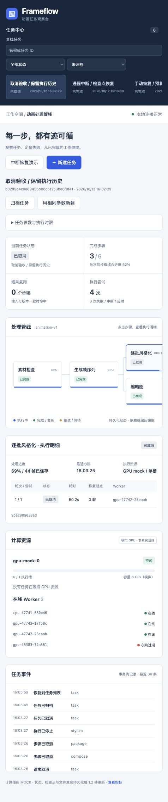
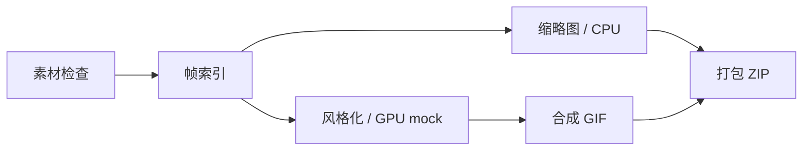

# Frameflow · 可恢复的 AI 动画任务管线

[公开源码](https://github.com/zhangshuyan1160-ops/observable-ai-pipeline) · [下载交付 ZIP](https://github.com/zhangshuyan1160-ops/observable-ai-pipeline/raw/refs/heads/main/delivery/observable-ai-pipeline-v0.2.0.zip) · [提交说明](docs/submission.md)

题 D 的两天 MVP。计算和 GPU 使用 MOCK，状态事务、独立 Worker、进程中断、检查点和文件产物真实执行。无需服务器、CUDA、大模型、Node 构建链或 Docker Desktop。



## 五分钟了解

提交动画任务立即返回 ID；6 个步骤按依赖执行。可注入临时错误、重试耗尽、永久错误或超时；真实杀死 Worker 后从每 4 帧的检查点继续。相同输入和版本复用已校验产物，生成可下载的 GIF、PNG 和 ZIP。



**v0.2 新增任务取消、全量任务搜索/分页/归档，修复队列饥饿并补充真实数据库中断与全栈重启演练。** [本轮优化与验收](docs/priority-one.md) · [60 分钟真实故障演练](docs/evidence/recovery-hour.json) · [31 项测试报告](docs/evidence/tests-v0.2.xml) · [真实服务证据](docs/evidence/live-demo.json) · [验收范围与未测项](docs/failure-matrix.md)

## 本地运行（推荐，已在 Apple silicon Mac 验证）

需要 Python 3.12+ 和 Git。系统 Python 3.9 不适用。全部安装到本项目，不修改系统 Python：

```bash
# 在解压后的项目根目录运行；python3.12 必须指向你的 Python 3.12+
PYTHON_BIN=python3.12 sh scripts/bootstrap.sh
.venv/bin/python scripts/dev.py start
```

浏览器打开 http://127.0.0.1:8765 。接口文档 `/docs`，指标 `/metrics`。启动器管理一个 API、一个 CPU Worker、两个竞争单槽资源的 GPU mock Workers。首次初始化本地 PostgreSQL；按 Ctrl+C 停止，重新启动保留任务和产物。

`pgserver==0.1.4` 为本地开发提供真实 PostgreSQL 16.2。这个捆绑版本仅用于隔离的本地演示，不作为公网生产数据库；生产或 Linux 评审可使用维护中的 PostgreSQL 16 实例。原生 Windows 未验证，可用 WSL2 / Compose。

```bash
# 另一个终端，均在项目根目录
.venv/bin/python scripts/dev.py status
.venv/bin/python scripts/dev.py interrupt gpu   # 杀死并重启本项目两个 GPU Workers
.venv/bin/python scripts/dev.py interrupt api
.venv/bin/python scripts/dev.py stop
```

已安装独立 PostgreSQL 时：安装 `requirements.lock` 与本项目，导出 `DATABASE_URL` 和 `ARTIFACT_ROOT`，分别运行 `uvicorn pipeline.api:create_app --factory` 及 `python -m pipeline.worker --resource cpu/gpu`。API/Worker 必须使用同一数据库和产物目录。

提供 `docker compose up --build` 备选，默认端口仍只绑定本机，持久卷保存状态和产物。**Docker 在本机未安装，因此 Compose 尚未运行验证**；不将其列为已验收启动路径。

## 验证与演示

```bash
.venv/bin/ruff check src tests scripts
.venv/bin/ruff format --check src tests scripts
.venv/bin/pytest -q --basetemp=.local/pytest
# 本地服务启动后运行；会终止并重启本项目 Worker/API
.venv/bin/python scripts/verify_demo.py
# 独立数据库和子进程，不影响正在演示的服务
.venv/bin/python scripts/verify_recovery.py --duration 8
```

测试使用真实 PostgreSQL，每例独立数据库，自动清理。CI 使用 PostgreSQL service 和 `TEST_DATABASE_URL`，不依赖 pgserver；远程 CI 状态以 GitHub Actions 实际结果为准。[五分钟演示脚本](docs/demo.md)

## 接口示例

```bash
curl -X POST http://127.0.0.1:8765/api/tasks \
  -H 'Content-Type: application/json' \
  -H 'Idempotency-Key: demo-001' \
  -d '{"title":"重试演示","cache_enabled":false,"fault_mode":"transient_once"}'
```

同一个幂等键+同一请求返回原任务；同键不同请求返回 409。GET `/api/tasks/{id}` 查状态和尝试；GET `/api/tasks/{id}/events?after_seq=0` 增量读取事件；POST `/api/steps/{id}/retry` 为失败步骤创建新一轮尝试。新请求键控制新任务，缓存指纹控制是否重算，两者互不替代。

## 任务管理与升级

页面支持名称/ID 搜索、状态筛选、历史分页、参数详情、取消和归档恢复。对应接口：

- `GET /api/tasks?q=关键词&status=CANCELLED&view=all&limit=30`，用返回的 `next_cursor` 作为下一页 `before`。
- `POST /api/tasks/{id}/cancel`：运行中先 CANCELLING，Worker 确认停止后 CANCELLED；失联时明确标记“停止未确认”。
- `POST /api/tasks/{id}/archive?archived=true`：归档已结束任务；`false` 恢复。归档不删除文件。

从 v0.1 升级须先停止全部旧 API/Workers，再启动新版；schema v2 自动迁移且保留历史。不要同时运行不支持取消的旧 Worker。

## 工程目录与节省空间

```text
src/pipeline/      执行器、API、Worker、存储、动画处理与静态页面
scripts/           安装、启动、故障验收、打包、清理和 token 快照
tests/             真实 PostgreSQL 测试
docs/              设计、计划、Skills 来源、提交说明、测试证据
.local/            数据库、产物、下载缓存、日志、临时验证（忽略）
.venv/             可重建依赖（忽略）
dist/              本地构建 ZIP 与 SHA-256 清单（忽略）
delivery/          GitHub 交付 ZIP 与摘要（导出源码包时排除）
```

源码、环境、运行数据均集中于这个独立目录。当前本机实际占用见 [environment.md](docs/environment.md)。不把数据库、个人路径、凭据或虚拟环境上传 GitHub。

```bash
# 必须先提交源码；仅打包 Git HEAD，不打包运行文件
python3 scripts/package.py
# 默认只报告，不删除；--apply 只清理指定的可重建缓存
python3 scripts/clean.py
python3 scripts/clean.py --apply
# 上传和校验完成、停止服务后，需要进一步节省空间时
python3 scripts/clean.py --dependencies --apply
```

清理脚本保留源码、ZIP、数据库和动画产物。源码 ZIP 可解压后用 bootstrap 重建环境；ZIP 不包含个人演示任务数据库备份。GitHub 仓库保留可浏览源码；压缩包是额外交付物。delivery/manifest.json 记录本地源码快照 commit 与 ZIP 的 SHA-256；GitHub 上传提交可能不同，下载后按 SHA-256 校验文件。

## 说明与边界

- [面试提交简要说明](docs/submission.md)：逐项回应题目。
- [设计](docs/architecture.md)：状态、事务、恢复、GPU 和小时级扩展。
- [两天计划](docs/plan.md) · [Skills 检索及新增清单](docs/skills.md) · [工作记录与 AI 用量](docs/worklog.md)。

这是单机固定 DAG 执行器，保证至少一次执行和有所有权校验的结果提交。未实现任意素材上传、多租户鉴权、真实 GPU 或生产级多机调度；不保证 exactly-once 计算。不把未完成的小时级压测或 Compose 验证写成已通过。
