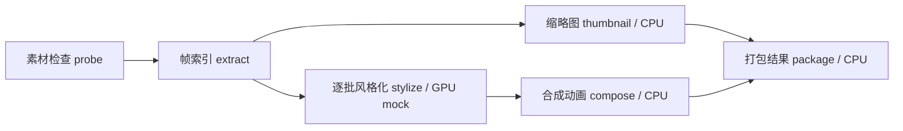
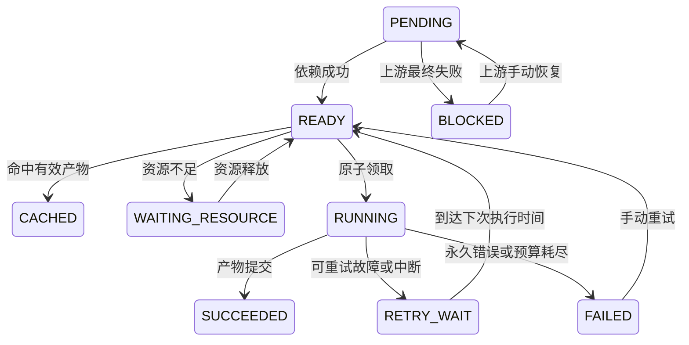

# 可恢复动画任务管线设计

状态：下文为 MVP 已实现设计，扩展项明确单列。源码采用 FastAPI + psycopg 显式 SQL + PostgreSQL schema v1；没有引入 SQLAlchemy/Alembic。19 项集成测试和真实服务中断验收见 evidence。

## 执行边界

控制面由 FastAPI 和 PostgreSQL 组成，执行面是独立 Worker。API 创建任务、步骤快照和创建事件后返回 `202 Accepted`，包含 `task_id` 与查询 URL。Worker 定期领取就绪步骤，每个进程同一时刻执行一个 attempt；可以启动多个 CPU Worker 和两个竞争同一资源槽的模拟 GPU Workers。

PostgreSQL 同时承担队列和状态存储，避免“数据库写成功、消息投递失败”的双写窗口。领取使用短事务和行锁；实际计算、等待、文件写入不占数据库长事务。队列领取使用 `FOR UPDATE SKIP LOCKED`，其适用边界是队列式并发访问，而非一般一致性查询。[PostgreSQL 官方 SELECT 文档](https://www.postgresql.org/docs/current/sql-select.html)

长期任务不依赖 HTTP 连接存活，也不放在 FastAPI 的进程内 BackgroundTasks 中。FastAPI 官方亦将更重的后台计算引向独立任务工具。[FastAPI Background Tasks](https://fastapi.tiangolo.com/tutorial/background-tasks/)

## 动画处理 DAG



| 步骤 | 输入与产物 | 独立恢复的理由 | 恢复粒度 |
| --- | --- | --- | --- |
| probe | 固定样例/输入哈希 → 元信息 JSON | 输入校验失败应早停，避免浪费算力 | 整步 |
| extract | 合成素材元数据 → 帧索引 JSON（PNG 在 stylize 生成） | 分帧结果稳定，可供多个后续步骤复用 | MVP 整步；扩展按时间段 |
| stylize | 帧 manifest、模型版本、seed、参数 → 处理帧 | 最耗时且需要 GPU；帧批次有独立输入输出 | 每批，例如 4 帧 |
| thumbnail | 原始帧 → 缩略图 | 与风格化无依赖，便于演示扇出 | 整步 |
| compose | 已处理帧 → 小 GIF 或动画产物 | 通常重新编码比任意位置恢复编码器简单 | 整步 |
| package | 动画、缩略图 → ZIP + manifest | 产物命名和发布必须可重复 | 整步 |

mock 步骤至少生成可校验的小文件；可用固定图形帧模拟动画，附明确 MOCK 标签。不只 `sleep` 后返回“成功”，否则无法验证产物复用和损坏检测。默认无故障任务通常约 10–15 秒（随资源等待变化）；长任务模式可调每批耗时/批数。

步骤定义是 domain.py 的固定 `STEPS` 列表（key、label、depends_on、resource）；缓存定义版本 animation-v1、handler 版本 1，检查点 schema=1。显存需求、超时和重试参数作为任务参数统一配置，不提供逐步自定义策略编辑。创建时校验唯一 key、依赖存在、无环；保存完整不可变快照。所有父步骤 `SUCCEEDED/CACHED` 后才能领取。改变处理语义创建新任务/定义版本，不原地修改正在运行任务。

## 状态模型

### Task

`QUEUED → RUNNING → SUCCEEDED | FAILED`。手动重试允许 `FAILED → RUNNING`，历史不清空。

- `QUEUED`：已接受但尚未开始。
- `RUNNING`：任务尚有可推进的步骤；可附派生 `phase=executing/retrying/waiting_resource/recovering`。
- `SUCCEEDED`：全部步骤成功或命中有效缓存。
- `FAILED`：存在不可继续的失败，且独立分支已结束、没有正在执行或可继续的步骤。失败分支的后代显示 `BLOCKED`。

聚合规则集中在一个服务中，不让各 API 自行推断。P0 无暂停/取消状态；若加入取消，必须另加 `CANCELLING` 和明确的停止确认逻辑，不能只改界面状态。

### Step



`CACHED` 是成功终态，不产生虚假的计算 attempt，记录来源 artifact 与命中事件。等待资源不消耗执行尝试次数。缓存完整性校验失败按未命中处理，并追加失效事件。

### Attempt

每次实际领取创建新记录：`RUNNING → SUCCEEDED | FAILED | TIMED_OUT | INTERRUPTED`。恢复创建新 attempt，旧的不会被改成新执行。记录 `attempt_no`、`retry_round`、worker、开始/结束、错误类别、租约代次、恢复起点。

自动尝试默认每个 retry round 最多 3 次（包括首次）；指数退避加抖动，例如约 1、2 秒。`next_run_at` 持久化，不用长时间 sleep 霸占 Worker。手动重试只接受失败步骤，为该步骤创建新 retry round，并恢复被它阻塞的后代；保留已完成的独立步骤。不修改输入；如需修改输入或超过任务总体截止时间，创建新任务。

## 持久化什么，为什么

| 数据 | 关键字段 | 原因 |
| --- | --- | --- |
| `tasks` | ID、请求幂等键、输入摘要、definition snapshot、状态、deadline、事件序号、时间戳 | API 重启可查询；新旧版本隔离；重复提交不重复创建 |
| `steps` | task/key、依赖、状态、当前 attempt、fencing token、next_run_at、检查点引用、进度 | 决定恢复位置、谁有权提交、何时可执行 |
| `attempts` | step、retry round、序号、worker、起止时间、heartbeat/lease、错误类别与摘要 | 区分业务失败、超时和进程丢失；保留所有尝试 |
| `events` | task/seq、step/attempt、类型、时间、脱敏 payload | 上游分页查历史；界面断线重连补查 |
| `artifacts` | 类型、不可变 URI、SHA-256、大小、创建 attempt（完整性按需重新校验） | 只复用真实存在的结果；定位损坏或来源 |
| `cache_entries` | scope、fingerprint、artifact/manifest、定义版本、创建时间 | 跨任务复用；防止旧模型和不同输入误命中 |
| `workers` | worker ID、能力、最后心跳、当前 attempt | 展示执行者、离线状态；辅助诊断 |
| `resource_slots` | slot ID、资源类型、容量、占用 attempt、token、lease expiry | 单槽 GPU 排队；占用与领取同事务 |

固定 DAG 的依赖存步骤记录/定义 JSON，不单建通用编排平台。检查点采用带 schema version 的 JSON manifest 和产物引用；帧数据不塞数据库。错误堆栈放日志，数据库只放可展示的摘要与关联 ID。

使用 UTC `TIMESTAMPTZ`、必要的 NOT NULL/CHECK、`(task_id, step_key)` 与请求幂等键唯一约束、`(step_id,retry_round,attempt_no)` 唯一约束。为就绪步骤、`next_run_at`、租约到期、`(task_id,seq)` 建索引。以数据库时间计算租约，避免 Worker 时钟偏差。

“当前状态表 + 事务内追加事件”是审计历史设计，不宣称完整 event sourcing。事件保留和数据库备份是不同问题；不承诺只靠事件重建全部文件。

## 并发领取与故障恢复

1. 所有修改遵循一致锁顺序：task → step → resource slot，避免领取、完成、回收互相死锁。任务行锁仅覆盖短事务，不覆盖计算。
2. 领取就绪步骤，检查依赖、`next_run_at`、任务 deadline 和资源；在一个事务内新建 attempt、递增 fencing token、占用 slot、标记 RUNNING、记录事件。
3. 计算期间每约 2 秒续租，初始租约 10 秒；回收扫描间隔约 1 秒。心跳说明执行所有权仍有效，进度说明业务做了多少，两者不能混为一谈。
4. 心跳、进度、checkpoint、完成都以 `step.current_attempt_id == attempt_id AND fencing_token == token AND lease_expires_at > DB_NOW` 为条件更新。更新 0 行就停止提交，记录旧 attempt 被拒绝。
5. 进程崩溃后不会再续租。回收器把过期 attempt 标记 `INTERRUPTED`，在重试预算内安排下一次执行；已成功步骤不变。
6. 演示目标：其他健康 Worker 存在时，在租约超时 + 扫描间隔 + 退避后接手，通常约 10–15 秒。所有 Worker 都停止时，先重启 Worker 才有执行进展；恢复时间从有可用 Worker 起计算。

回收器也是幂等的，可以由 Worker 周期运行；多个回收者通过相同行锁/条件更新避免重复回收。尝试超时与心跳超时分开：进程活着但计算卡住，仍会触发 attempt timeout；租约续期不得无限延长 attempt deadline。

**语义为至少一次执行、受 fencing 保护的状态提交和幂等产物发布。** Worker 可能做完计算却没来得及记成功，恢复后会重算；不能把它称为计算 exactly-once。真实外部收费 API 还需要服务方支持的幂等键。

## 产物提交与检查点

写入步骤：生成 UUID 隔离的临时文件 → 校验大小/摘要 → 在同一文件系统原子 rename 为不可变文件 → 事务检查所有权 → 写 artifact、step 成功、cache、event 并释放资源。持久卷可靠性是部署假设；涉及主机掉电时需 fsync 文件/目录，硬盘损坏仍需备份恢复。

- 文件写完但数据库未提交就崩溃：留下未引用文件；任务不算成功。可重算，后续 GC 清理孤儿文件。
- 数据库提交成功但响应丢失：查询已提交状态；不重复改变任务结果。
- 旧 attempt 迟到：不能提交数据库，也不能覆盖新结果文件，因为文件路径不可变、按随机 UUID 隔离。

`stylize` 每批 4 帧：先写批次产物，再用同样的所有权校验提交 manifest 与 progress。检查点保存 schema=1、包含输入/参数/模型/handler 版本的 fingerprint，以及每个已完成帧的不可变路径、SHA-256 和大小。恢复前验证身份与文件完整性，只继续未完成批次；不兼容/损坏的检查点不盲目复用。检查点提交与进度更新同事务，进度不会领先于可恢复结果。

这里的“断点恢复”发生在批次边界；不会恢复 Python 调用栈或 GPU kernel 内部状态。合成动画阶段从头编码，这是有意选择的恢复粒度。

## 结果复用与失效

```text
fingerprint = SHA256(canonical_json({
  scope, step_key, handler_version, relevant_parameters,
  model_version, seed, ordered_upstream_artifact_digests
}))
```

本例 `probe` 的输入是预设素材类型和帧数；不支持任意素材上传。接入真实文件后，应改为原文件摘要。每个步骤只纳入会影响该步结果的参数：修改风格化模型会使 stylize、compose、package 失效，probe、extract、thumbnail 可继续复用。耗时模拟参数、故障注入配置不属于结果语义；故障测试显式关闭缓存，避免命中缓存绕过注入点。

只发布成功完整的缓存项。命中时验证文件存在、大小/摘要、manifest 兼容性；损坏项失效并重算。缓存 key 唯一冲突用事务解决，不能“先查不存在，再无条件插入”。MVP 允许两个任务同时未命中而重复计算，只有一个规范缓存引用成为最终可复用结果；跨任务 single-flight 去重是扩展项。

新任务是否被创建由请求幂等键控制；新任务是否重算由步骤缓存控制。这是不同层次。缓存 scope 在 MVP 是本地 demo scope，多用户环境必须加入租户/权限范围。真实非确定性模型只有在允许复用既有样本的策略下才开启缓存，固定 seed 也不等于所有硬件上逐位一致。

## 查询与观察

| 已实现接口 | 行为 |
| --- | --- |
| `POST /api/tasks` | 校验参数与定义；幂等创建；返回 202 + ID |
| `GET /api/tasks` | 状态过滤与游标分页 |
| `GET /api/tasks/{id}` | 当前任务、步骤、进度、等待原因与版本 |
| `GET /api/tasks/{id}/events?after_seq=N` | 只查该任务已提交事件，按 seq 分页 |
| `GET /api/steps/{id}/attempts` | 每次尝试、错误、恢复位置、Worker |
| `POST /api/steps/{id}/retry` | 只对失败步骤操作；不破坏历史，重复点击返回 409，不重复安排执行 |
| `GET /api/artifacts/{id}` | 从受控目录返回已登记产物 |
| `GET /api/resources` | Worker 和模拟 GPU 槽状态 |
| `GET /healthz`、`GET /readyz` | 进程存活和数据库可用性分开 |
| `GET /metrics` | 按步骤/状态计数、attempt 终态计数、耗时 sum/count、模拟槽占用 |

事件使用**任务内顺序号**：持有任务行锁时分配并和状态同事务提交。不能直接用全局自增 ID 作严格不漏事件的游标，否则事务乱序提交可能漏掉较小 ID 的晚提交事件。

UI 每 1.2 秒轮询任务列表和资源；详情终态在 updated_at 不变时停止重复获取。事件按 seq 增量分页，内存保留最近 500 条、显示最后 30 条。主视图显示 DAG，选择步骤查看 attempts/事件/产物。展示每次执行耗时、GPU 等待时间、上次心跳；next_run_at 和重试退避记录可从 API/事件查询。整体百分比只标为估算；有实际批次计数时显示 `已完成批次/总批次`，不伪造精确 ETA。

结构化日志包含 `task_id`、`step_key`、`attempt_id`、`worker_id`、`event_type`、`entry_point`。这些高基数字段只放日志/事件，不作为 Prometheus labels。指标按有限的 step type、resource type、outcome 聚合。事件用于恢复和审计，日志用于排障；日志收集故障不应把已成功的任务回滚。

## GPU MVP 和真实 GPU 边界

MVP 一个 `gpu-mock-0` 槽、模拟 8 GiB 显存；风格化要求 4 GiB，独占使用。并发提交两个任务时一个执行一个等待，界面明确显示模拟占用、总容量和等待时间；请求显存需求可从 task.params 查询。需求超过总容量直接给出不可调度原因，不永远排队。重试退避期间释放槽。

租约与 attempt 在同一事务管理，避免双重授予**逻辑槽位**。网络分区时 fencing 只能阻止旧 Worker 写入结果，不能杀掉旧进程，更不能证明显存已释放。真实 GPU 需要节点代理确认进程/容器退出后再发放资源，无法确认时隔离节点，不立即复用。

真实扩展包括资源标签/显存估计、专用 GPU 队列、模型预热、显存 OOM 分类、批大小调整、队列年龄与公平性。不能反复用同一批大小重试确定性 OOM；改变批大小若影响语义，应记录参数变更与新版本。

实际 GPU 利用率、显存、温度和功耗可通过 NVIDIA DCGM Exporter 暴露给 Prometheus，结合任务/attempt 与设备映射诊断。MVP 不声称已经接入真卡或测得 GPU 性能。[NVIDIA GPU Telemetry](https://docs.nvidia.com/datacenter/cloud-native/gpu-telemetry/latest/)

## 从秒级扩展到小时级

| 方面 | 秒级演示 | 小时级变化 |
| --- | --- | --- |
| 请求生命周期 | 接受后即返回 | 保持相同异步模型，不把 HTTP timeout 调成数小时 |
| 超时 | 短 attempt deadline | 分开排队、单次执行、心跳、总体 deadline；不能只扩大一个 timeout |
| 恢复损失 | 一个小批次 | 根据重算成本与存储开销确定 checkpoint 间隔 |
| 执行隔离 | mock Worker | 子进程/容器隔离，失联确认、优雅关停与强制终止 |
| 进度 | 批次计数 | heartbeat 与 progress 分离，检测有心跳无进展 |
| 产物 | 共享本地卷 | 对象存储、分块上传、生命周期、摘要与备份 |
| 调度 | 少量固定 Worker | 能力路由、背压、配额、优先级与防饥饿 |
| 升级 | 固定定义版本 | 运行中定义快照，旧 Worker 兼容、检查点版本迁移 |
| 观察 | 轮询与少量事件 | 限流/分页/保留策略，增量推送、事件归档、低基数指标 |
| 外部 AI 服务 | 同步 mock | 持久化 provider job ID；提交/等待/取结果拆开，避免重复付费 |

对于图像/视频模型，分帧、逐帧或逐片段推理、合成、发布通常是良好任务边界。单帧张量算子、每个小 denoising step 通常太细，持久化和传输成本可能超过收益；是否在模型内部恢复取决于该模型能否导出兼容中间状态。外部异步推理的等待阶段不应占用 GPU Worker。

Temporal 对 Activity 超时、重试和心跳有成熟模型，是后续生产化的参考；本 MVP 的数据库执行器并不等同于 Temporal 的历史重放。[Temporal Activity Execution](https://docs.temporal.io/activity-execution) · [Python 错误处理与心跳](https://docs.temporal.io/develop/python/best-practices/error-handling)

## 明确限制

不覆盖多机容错、数据库/磁盘永久损坏、通用任意 DAG 编辑、真 GPU 驱动恢复、多租户生产鉴权、物理计算 exactly-once 或真实 AI 质量。公开仓库可完整交付；若额外部署可写公网实例，需要限制创建频率和资源额度，故障注入仅限本地 demo 模式。

## 已知实现取舍

- schema.sql 使用 IF NOT EXISTS 初始化 v1；不是通用版本迁移系统。滚动升级、多版本 handler 调度尚未实现。虽然任务保存 definition 快照，执行代码目前只支持 animation-v1；不能在有未完成任务时直接替换不兼容的 handler。
- 每次操作新建 psycopg 连接，未做连接池；领取会锁定最多 32 个候选任务。本机少量任务已验证，大吞吐需收缩锁定范围、加连接池和公平调度。
- 缓存完整性校验在领取事务内读取小文件；大视频必须移到锁外校验，再带摘要/版本条件提交，避免长事务。
- 事件在数据库事务内提交，是事实来源；stdout 日志可能在事务最终回滚前已输出，只用于排障。/metrics 来自数据库聚合，无完整 OTel trace 或 Prometheus/Grafana 服务。
- 产物目录采用 UUID 隔离（而非可变文件覆盖）；每个 artifact 记录创建 attempt。失去所有权后新生成的孤儿文件不发布；自动引用计数 GC 尚未实现。
- 父产物在缓存命中后再次被外部删除，下游会失败；新建相同输入任务可使缓存校验失效并重算。系统不自动回退已成功的父节点，也不能修复磁盘永久损坏。
- 成功步骤只存最终产物引用，清空检查点；逐批临时 PNG 暂留在本地目录，限制演示任务数量。
